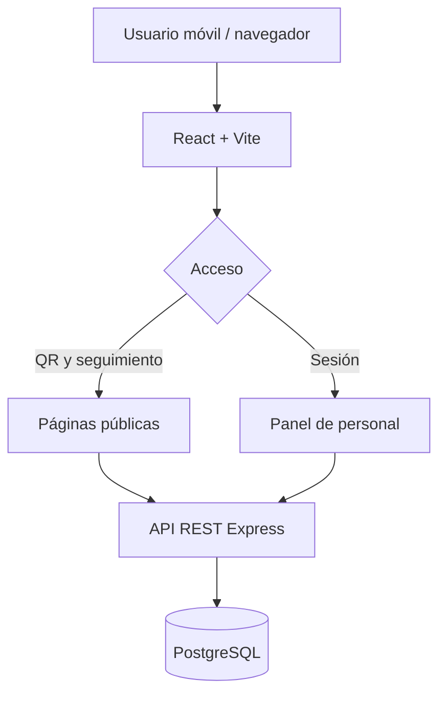

# ReportaLab

**ReportaLab** es una aplicación web full-stack para reportar fallas en equipos de laboratorios y aulas mediante códigos QR. Una persona escanea el QR, confirma a qué equipo pertenece, describe el problema y obtiene un código de seguimiento. El personal técnico administra los casos desde un panel privado.

> **Proyecto personal de portafolio.** Todos los equipos, ubicaciones, usuarios e incidencias iniciales son ficticios. No es una aplicación oficial de USIL, ZHI ni de otra institución. El entorno demo no está diseñado para almacenar información personal o confidencial.

## Tecnologías

| Capa | Herramientas |
|---|---|
| Interfaz | React 18, TypeScript, Vite, CSS responsive y Lucide |
| Servidor | Node.js 20+, TypeScript, Express, Zod |
| Persistencia | PostgreSQL 16, SQL parametrizado con `pg` |
| Autenticación | Cookies HTTP-only, JWT firmado (HS256), bcrypt |
| Códigos QR | `qrcode` (PNG generado en el navegador) |

## Requisitos

- Node.js 20 o superior y npm.
- PostgreSQL 16 local **o** Docker Desktop con Docker Compose.
- Navegador actual.

## Instalación (local)

Desde el directorio raíz del proyecto:

```bash
npm install
```

Inicia PostgreSQL (opción recomendada con Docker):

```bash
docker compose up -d
```

Copia el archivo de configuración de ejemplo. En PowerShell:

```powershell
Copy-Item apps/api/.env.example apps/api/.env
```

En macOS/Linux:

```bash
cp apps/api/.env.example apps/api/.env
```

En `apps/api/.env`, reemplaza `JWT_SECRET` por un valor nuevo y aleatorio **de al menos 32 caracteres**. `DATABASE_URL` ya coincide con la base creada por `docker-compose.yml`, que es **solo para desarrollo local**. Si usas PostgreSQL por tu cuenta, ajusta la URL.

Crea las tablas y carga datos ficticios:

```bash
npm run db:migrate
npm run db:seed
```

Arranca frontend y API:

```bash
npm run dev
```

- **Aplicación web:** http://localhost:5173
- **API:** http://localhost:4000/api/health
- **Panel del personal:** http://localhost:5173/login

Vite redirige `/api` al puerto 4000; por eso en desarrollo `VITE_API_URL` debe permanecer vacío (no necesitas crear `apps/web/.env`).

### Usuarios de demostración

Se crean al ejecutar `npm run db:seed` en un entorno que **no** sea `NODE_ENV=production`:

| Rol | Correo | Contraseña |
|---|---|---|
| Administrador | `admin@reportalab.demo` | `DemoAdmin2026!` |
| Técnico | `tecnico@reportalab.demo` | `DemoTecnico2026!` |

Estas credenciales son exclusivamente de prueba; no las reutilices en otros sistemas. El administrador puede crear, editar y eliminar equipos, además de gestionar incidentes. Al borrar un equipo con incidencias, también se elimina su historial asociado. El técnico puede gestionar reportes y ver los equipos y sus QR, pero no editarlos.

`db:seed` es **idempotente** en los equipos y usuarios predeterminados: puedes repetirlo sin duplicarlos. Solo genera incidentes iniciales si la tabla estaba vacía. Imprime códigos de seguimiento en la consola la primera vez que crea reportes.

## Recorrido de la demo (menos de un minuto)

1. Abre `/login` e ingresa como administrador. Entra a **Equipos y QR**.
2. Pulsa **Ver QR** en un equipo y después **Abrir formulario público**. También puedes descargar el PNG y escanearlo desde tu teléfono si el sitio es accesible desde ese dispositivo.
3. El formulario ya muestra el equipo, el código y la ubicación. Envía una falla de ejemplo y copia el código `RL-...` que recibes.
4. Regresa al panel: abre **Incidencias** → selecciona el reporte → cambia el estado a **En revisión** y guarda una nota interna.
5. Abre `/seguimiento` con el código que copiaste. Verás el nuevo estado, pero **nunca** la nota privada.

**Atención:** si ejecutas Vite únicamente en `localhost`, un QR escaneado desde otro teléfono **no** tendrá acceso al servidor. Para probarlo en tu red local, abre el panel desde la IP de tu PC en el puerto 5173 y habilita ese puerto en el firewall (Vite reenvía las llamadas a la API local); para LinkedIn, despliega ambos servicios en una URL HTTPS accesible al público.

## Arquitectura



```text
ReportaLab/
├── apps/
│   ├── api/
│   │   ├── migrations/001_initial.sql
│   │   ├── src/{index,db,migrate,seed}.ts
│   │   └── .env.example
│   └── web/
│       ├── src/components/UI.tsx
│       ├── src/pages/{PublicPages,PanelPages}.tsx
│       ├── src/{App,api,types,styles,main}.tsx
│       └── .env.example
├── docs/demo-script.md
├── docker-compose.yml
└── README.md
```

### Entidades

- `users`: correo, contraseña hasheada, rol (`ADMIN` o `TECHNICIAN`).
- `equipment`: código de inventario, nombre, tipo, ubicación, estado operativo y token QR.
- `incidents`: equipo, categoría, descripción, prioridad, estado, código de seguimiento, fechas.
- `incident_events`: creación del caso, cambio de estado o nota interna, con actor y marca temporal.

Los estados posibles de incidentes son: **Recibido → En revisión → En reparación → Resuelto**. El personal puede cambiar entre estados y reabrir casos. Las consultas públicas muestran un estado actual, no las notas internas ni los nombres del personal.

### API REST

| Método | Ruta | Acceso |
|---|---|---|
| `GET` | `/api/health` | Público |
| `GET` | `/api/public/equipment/:token` | Público; solo información básica |
| `POST` | `/api/public/incidents` | Público; con limitación de frecuencia |
| `GET` | `/api/public/incidents/:trackingCode` | Público; solo resumen de seguimiento |
| `POST` | `/api/auth/login` | Público |
| `POST` | `/api/auth/logout` | Sesión o público |
| `GET` | `/api/auth/me` | Personal autenticado |
| `GET` | `/api/dashboard/stats` | Personal autenticado |
| `GET` | `/api/incidents` | Personal autenticado; filtros por estado, categoría, equipo y búsqueda |
| `GET` | `/api/incidents/:id` | Personal autenticado; historial privado |
| `PATCH` | `/api/incidents/:id/status` | Personal autenticado |
| `POST` | `/api/incidents/:id/notes` | Personal autenticado |
| `GET` | `/api/equipment` | Personal autenticado |
| `POST` | `/api/equipment` | Administrador |
| `PATCH` | `/api/equipment/:id` | Administrador |
| `DELETE` | `/api/equipment/:id` | Administrador; acepta `{ "deleteHistory": true }` para eliminar también incidencias, notas y eventos asociados |

La lista de incidencias devuelve un máximo de 100 casos recientes; el catálogo, un máximo de 500 equipos. La paginación y búsquedas ampliadas son futuras mejoras.

## Validación y seguridad

- Validación en servidor mediante Zod y en formularios del navegador.
- Consultas SQL parametrizadas (`$1`, `$2`, etc.).
- Hash de contraseñas con bcrypt (12 rondas).
- Cookie `httpOnly` de sesión, `sameSite=lax` y `secure` en producción.
- Autorización de roles comprobada en la API, no solamente en React.
- Tokens QR de 20 bytes aleatorios y códigos de seguimiento de 9 bytes aleatorios; ambos con identificadores no secuenciales.
- Las consultas públicas no devuelven las notas de `incident_events` ni los correos del personal.
- Límite de intentos de login, reportes y consultas públicas.
- Se prohíbe usar datos personales o secretos en el entorno de demostración.

### Compilar

```bash
npm run build
```

La compilación del API produce `apps/api/dist`; la del frontend produce `apps/web/dist`. Para iniciar la API compilada:

```bash
npm start
```

### Pruebas manuales sugeridas

- Crear un reporte desde `/e/:token`; verificar que aparezca en el panel.
- Consultar su código, actualizar el estado y verificar que cambie en el seguimiento público.
- Añadir una nota interna y confirmar que nunca aparezca en la respuesta pública.
- Ingresar como técnico y verificar que la API rechace crear o editar equipos (`403`).
- Probar código QR inválido (`404`), acceso anónimo a rutas privadas (`401`), y formulario con menos de 12 caracteres (`400`).
- Revisar navegación en pantallas de 375 px y de escritorio, y el acceso por teclado.

## Antes de publicar

### Demo pública económica con Render y Neon

El blueprint render.yaml publica la API y el frontend desde el mismo dominio, y ejecuta las migraciones al iniciar. Neon aloja PostgreSQL por separado para que la base no dependa de la base gratuita de Render, que vence a los 30 días. La capa gratuita actual de Neon ofrece hasta 1 GB por proyecto y escala el cómputo a cero cuando está inactivo; Render Free duerme la aplicación tras 15 minutos sin tráfico, por lo que la primera visita puede tardar cerca de un minuto en despertar. Revisa los límites vigentes de [Neon](https://neon.com/pricing) y [Render](https://render.com/docs/free).

1. Sube el repositorio a GitHub y crea un proyecto PostgreSQL en Neon.
2. Copia la URL de conexión de Neon. No la publiques ni la añadas al repositorio.
3. En Render, crea un **Blueprint** desde el repositorio. Cuando lo solicite, configura DATABASE_URL con la URL de Neon. El blueprint genera JWT_SECRET automáticamente.
4. Al terminar el primer despliegue, carga datos ficticios desde tu PC en esa base aislada. En PowerShell, desde la raíz del proyecto:

   ~~~powershell
   $env:DATABASE_URL = "URL_DE_CONEXION_DE_NEON"
   $env:NODE_ENV = "development"
   npm run db:seed -w @reportalab/api
   Remove-Item Env:DATABASE_URL, Env:NODE_ENV
   ~~~

5. Prueba el sitio HTTPS, el inicio de sesión, los QR y el seguimiento. Puedes compartir la URL de Render en LinkedIn. Las credenciales de demo son públicas y permiten modificar datos de prueba; no uses datos reales.

La base de Neon no caduca a los 30 días, pero la cuenta gratuita tiene cuotas y el cómputo queda inactivo entre consultas. Para datos importantes, crea copias de seguridad antes de cambios o eliminaciones.

Para cualquier despliegue: usa NODE_ENV=production, un JWT_SECRET exclusivo y HTTPS. Revisa que el QR lleve a la URL final; su destino se genera con el origen donde está abierto el panel.

**Limitación de la entrega:** si el entorno que generó este repositorio no permite descargar dependencias, ejecutar Docker ni abrir un navegador, el código y los datos de demo quedan listos para compilar localmente, pero **no puede afirmarse que se haya probado de extremo a extremo** hasta completar las verificaciones anteriores. Las capturas reales deben obtenerse después de iniciar el proyecto, sin sustituirlas por imágenes simuladas.

---

## English summary

**ReportaLab** is a full-stack portfolio demo for reporting faults in educational labs through device-specific QR codes. Visitors can report an issue anonymously and track its status with a random reference code. Authenticated technicians update incident statuses and add private notes; administrators also manage equipment and download QR codes. Built with React, TypeScript, Express, and PostgreSQL. All sample data and accounts are fictional; no university or business uses or endorses this demonstration.

To run locally: `npm install`, `docker compose up -d`, copy `apps/api/.env.example` to `apps/api/.env`, configure a new `JWT_SECRET`, then run `npm run db:migrate`, `npm run db:seed`, and `npm run dev`. Do not deploy demo credentials to a real production environment.
